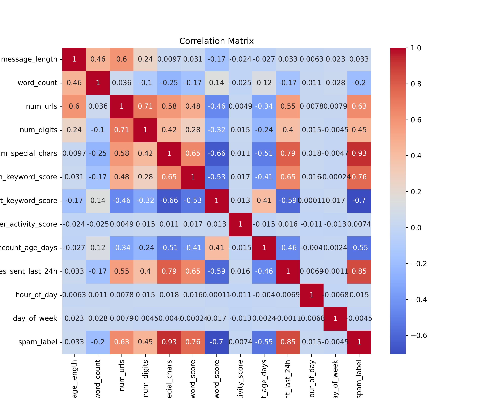
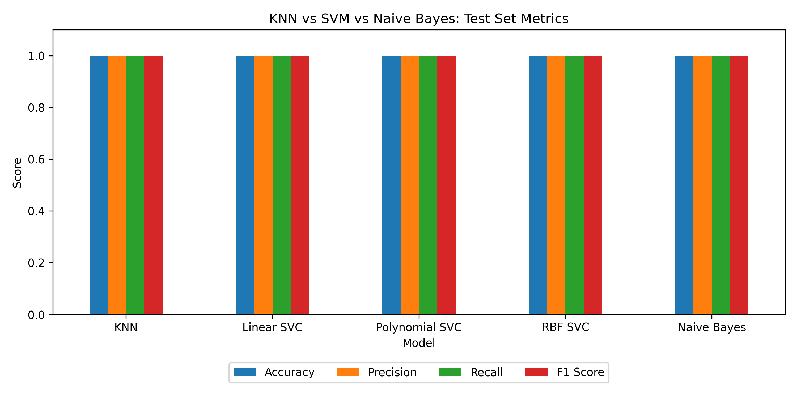

# ✉️ Message Intelligence System

**Spam vs Legitimate message classification using KNN, SVM and Naive Bayes**

Supervised Learning, Project 4 | Author: Harshal Vora ([HarshalVora86](https://github.com/HarshalVora86))

| Deliverable | Link |
|---|---|
| 🚀 Live Streamlit App | [messageintelligencesystemsl.streamlit.app](https://messageintelligencesystemsl.streamlit.app/) |
| 🎥 Video Explanation | [Watch the project overview](https://drive.google.com/file/d/109jQe46a_nf6DF0fp1fADjR6mhRsRRAL/view?usp=sharing) |
| 📓 Notebook | [`Notebook/Message_Intelligence_System.ipynb`](Notebook/Message_Intelligence_System.ipynb) |

---

## 📌 Project Overview

The goal is to classify incoming messages as:

- `0` → Legitimate message
- `1` → Spam message

Three families of classifiers are built and compared, and their behaviour is explained with conditional probability and Bayes' theorem:

| Family | Model |
|---|---|
| Distance-based | K-Nearest Neighbors (KNN) |
| Margin-based | Support Vector Machine (Linear, Polynomial, RBF) |
| Probabilistic | Gaussian Naive Bayes |

---

## 📂 Dataset

`Dataset/Message_Intelligence_Dataset_5200.xlsx`: 5,200 messages, 16 columns, no duplicates.

- **Class balance:** 4,227 legitimate and 973 spam (18.7%)
- **Missing values:** `sender_activity_score` (106), `sender_account_age_days` (113), `messages_sent_last_24h` (162), filled with the median

| Feature | Description |
|---|---|
| `message_length`, `word_count` | Size of the message |
| `num_urls`, `num_digits`, `num_special_chars` | Content signals |
| `spam_keyword_score`, `legit_keyword_score` | Keyword scores |
| `sender_activity_score`, `sender_account_age_days`, `messages_sent_last_24h` | Sender behaviour |
| `hour_of_day`, `day_of_week` | Time features |
| `spam_label` | **Target** (0 = Legitimate, 1 = Spam) |

`message_id`, `message_text` and `timestamp` are dropped before modelling.

### Correlation matrix



---

## 🔬 What the Notebook Covers

| Part | Work done |
|---|---|
| **A. Theory** | Conditional probability, Bayes' theorem, Naive Bayes assumptions, KNN and SVM working principles, distance-based vs probabilistic vs margin-based classifiers |
| **B. Data preparation** | Features and target identified, median imputation, standard scaling, 80/20 train-test split (`random_state=50`) |
| **C. KNN** | K = 1 to 19, three distance metrics (Euclidean, Manhattan, Minkowski), misclassification check |
| **D. SVM** | Linear, polynomial and RBF kernels, support-vector count, comparison with KNN |
| **E. Naive Bayes** | Gaussian Naive Bayes with confusion matrix, per-class probabilities of URL / spam-keyword / digit flags, Bayes' theorem for P(Spam \| HasURL) and P(Spam \| NoURL) compared with `BernoulliNB` |
| **F. Evaluation** | Accuracy, precision, recall, F1 and TN/FP/FN/TP for all models, 5-fold stratified cross-validation, bar chart comparison |
| **G. Report** | Strengths and weaknesses, impact of Naive Bayes assumptions, interpretability trade-offs, business recommendation, final conclusion |

---

## 📊 Results

### Test set (1,040 messages: 852 legitimate, 188 spam)

| Model | Accuracy | Precision | Recall | F1 | TN | FP | FN | TP |
|---|---|---|---|---|---|---|---|---|
| KNN (K = 5) | 1.0 | 1.0 | 1.0 | 1.0 | 852 | 0 | 0 | 188 |
| Linear SVC | 1.0 | 1.0 | 1.0 | 1.0 | 852 | 0 | 0 | 188 |
| Polynomial SVC | 1.0 | 1.0 | 1.0 | 1.0 | 852 | 0 | 0 | 188 |
| RBF SVC | 1.0 | 1.0 | 1.0 | 1.0 | 852 | 0 | 0 | 188 |
| Gaussian Naive Bayes | 1.0 | 1.0 | 1.0 | 1.0 | 852 | 0 | 0 | 188 |



### 5-fold stratified cross-validation (F1)

| Model | Mean F1 | Std |
|---|---|---|
| KNN | 0.9995 | 0.001 |
| Linear SVC | 1.0000 | 0.000 |
| Polynomial SVC | 1.0000 | 0.000 |
| RBF SVC | 1.0000 | 0.000 |
| Naive Bayes | 1.0000 | 0.000 |

### Key findings

- **KNN:** perfect for K = 1 to 15 with all three distance metrics. At K = 17 and 19, accuracy drops to 0.999 and recall to 0.9947.
- **SVM:** the linear SVM uses only 13 of 4,160 training points (0.31%) as support vectors.
- **Naive Bayes:** the hand-calculated P(Spam | HasURL) = 0.6695 and P(Spam | NoURL) = 0.0616 match the model output exactly.
- **Best model for precision and recall:** all models tie at 1.0, so accuracy cannot separate them.
- **Why the scores are perfect:** the classes are almost perfectly separable (in the correlation matrix, `num_special_chars` has a 0.93 correlation with `spam_label`).

### Recommendation (from the notebook, Part G)

Use **Linear SVC** as the primary model: it matches the others, predicts quickly, needs no kernel tuning and its feature weights explain decisions. Send borderline messages to human review and validate on fresh labelled data before real-world use.

---

## 🚀 Streamlit App

Live app: **https://messageintelligencesystemsl.streamlit.app/**

The app loads the saved Linear SVC pipeline (median imputer + StandardScaler + model), so predictions use the same preprocessing as training.

- Takes the 12 message features as input.
- Shows the **Linear SVC spam score** (signed distance from the decision boundary).
- Shows **Spam**, **Legitimate**, or **Borderline** (inside the SVM margin, |score| < 1, send to human review).
- A threshold slider changes the spam cut-off.
- Expanders show the input data and the model's test-set metrics.

```
User Input → DataFrame → Saved Pipeline → Median Imputer + StandardScaler
→ Linear SVC → Spam Score → Spam / Legitimate / Review
```

---

## 📁 Repository Structure

```
├── app.py                  # Streamlit app
├── train_model.py          # Trains and exports the Linear SVC pipeline
├── requirements.txt
├── README.md
├── Dataset/
│   └── Message_Intelligence_Dataset_5200.xlsx
├── model/
│   ├── spam_svc_pipeline.pkl
│   └── metrics.json
├── Notebook/
│   └── Message_Intelligence_System.ipynb
└── Screenshots/
    ├── correlation_matrix.png
    └── model_comparison.png
```

---

## ⚙️ How to Run

```bash
pip install -r requirements.txt
python train_model.py
streamlit run app.py
```

`train_model.py` uses the same split as the notebook (`test_size=0.2`, `random_state=50`) and writes `model/spam_svc_pipeline.pkl` and `model/metrics.json`.

---

## 🛠️ Tech Stack

Python · Pandas · NumPy · Matplotlib · scikit-learn · Streamlit · Jupyter Notebook

---

## ⚠️ Limitations

- Perfect test scores and one dominant feature mean this dataset is easier than real traffic.
- The app takes numeric message features as input, not raw message text.

---

## 👤 Author

**Harshal Vora**
GitHub: [HarshalVora86](https://github.com/HarshalVora86) · LinkedIn: [Harshal Vora](https://www.linkedin.com/in/harshal-vora-344601251/)
